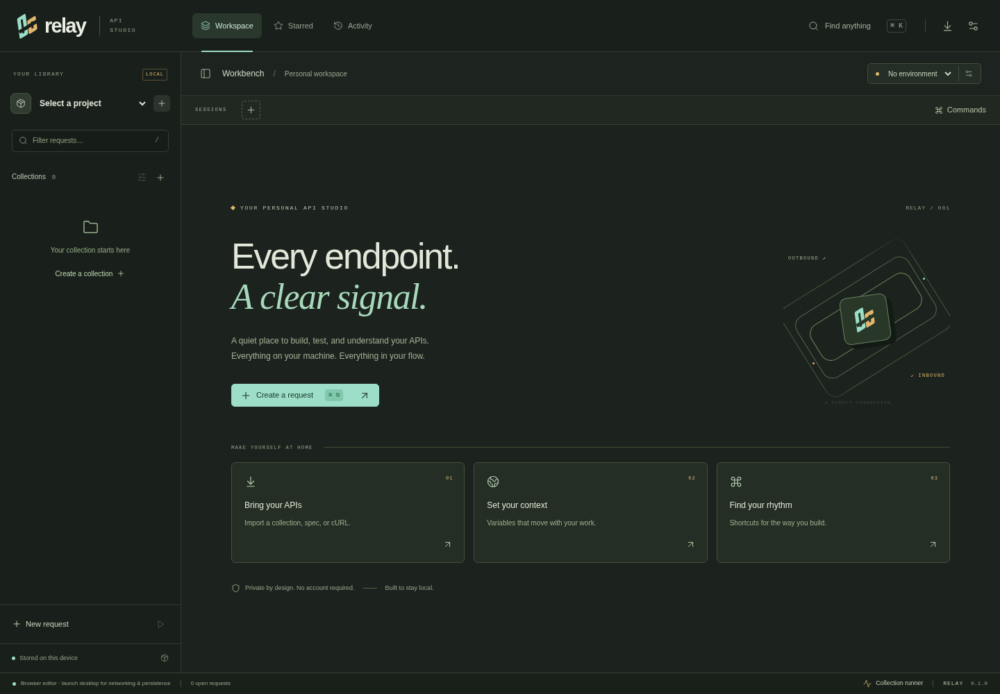

# Relay · API Studio

A local-first **desktop API client** built with React, TypeScript, Vite, Tauri 2, Rust and SQLite. No application account, cloud service, or Node backend. Production requests run through native Rust networking with TLS validation and no browser CORS restrictions.



This is a working **0.1 developer release**. It does not implement every feature of Postman, Insomnia or Bruno. See [validation and limitations](docs/VALIDATION.md) before distribution.

## Run the desktop app

Use Node.js 22.12+ (24 tested), the Rust toolchain declared in `rust-toolchain.toml`, and the [Tauri platform prerequisites](https://v2.tauri.app/start/prerequisites/).

On Debian/Ubuntu:

```sh
sudo apt-get update
sudo apt-get install -y build-essential pkg-config libssl-dev libwebkit2gtk-4.1-dev libayatana-appindicator3-dev librsvg2-dev
npm ci
npm run desktop
```

Windows needs the MSVC C++ build tools and WebView2; macOS needs Xcode command-line tools. The packaged application needs no Vite server or Node runtime.

`npm run dev` is the renderer only: native networking and SQLite deliberately do not work in a browser. There is no browser-fetch fallback or production mock transport.

No environment variable or credential is required to launch Relay. API-specific variables such as `baseUrl` and `accessToken` belong in the app's environment manager. Secure credentials use macOS Keychain, Windows Credential Manager, or a running/unlocked Linux Secret Service provider. A missing keychain produces an explicit error rather than a plaintext fallback.

## A different request workflow

- **Destination first:** create a session and paste a URL or cURL command directly into the address field. cURL parsing never runs a shell or sends automatically.
- **Request recipe:** expand Query, Identity, Headers, Payload, Checks & capture, or Delivery only when needed. Summaries remain visible when collapsed.
- **Out and back:** keep request configuration and response side by side, resize them, or choose a persistent stacked layout. Hide the library to focus.
- **Continue from the response:** inspect a JSON path and securely capture its value for the next request. Start assertions directly from the results view.
- **Stay local:** named requests, hierarchy, environments, settings, saved session IDs and history persist in SQLite; keychain values never enter portable exports.

Read [design decisions](docs/DESIGN.md) for the UX and mint/amber identity.

## Implemented capabilities

- Projects, collections, nested folders, saved requests, favorites, name search across projects, rename, request duplication, deletion and drag/drop movement within a project. Metadata-only navigation with windowed rows; request bodies load on demand.
- Standard/custom HTTP methods, query values, headers, cookies via headers, JSON/text/XML/HTML, URL-encoded forms, multipart fields and a file, binary uploads and GraphQL-over-HTTP JSON envelopes. Native cancellation, bounded bodies/responses, timeouts, same-origin redirects and decompression.
- Response status, total duration, time-to-headers, size, headers, cookies and redirects. Pretty/raw CodeMirror, search, folding, bounded lazy JSON tree/path inspection, sandboxed HTML, image preview, copy and native download.
- Global, project, collection, nested-folder, active-environment and request variables, deterministic precedence, nested interpolation, missing/cyclic variable errors and body-editor variable completion.
- Inherited/none, Bearer, JWT-as-bearer, Basic, API key, custom-header authentication. OAuth client-credentials and manual refresh-token grants. Explicit OS-keychain storage and masked fields.
- Declarative status/time/header/JSON-value/body/schema assertions, extraction into environments, and sequential saved collection runs with request chaining. Worker time budget; no arbitrary JavaScript execution.
- Postman collection/environment, OpenAPI 3 JSON/YAML, supported cURL and versioned native JSON imports. Atomic import rollback, portable export/restore, cURL generation, metadata history with retention, command palette and shortcuts.

### Login → capture → reuse

1. Add `baseUrl` to your active environment.
2. Send the API's login request.
3. Under **Checks & capture**, add extraction path `response.body.token`, variable `accessToken`, and enable Keychain. Alternatively, inspect the response JSON tree and choose **Use in next request** to capture immediately.
4. Choose Bearer authentication on a later request and enter `{{accessToken}}`.
5. Collection runs execute saved requests sequentially in name order; names such as `01 Login` and `02 Users` establish order. Refresh endpoints can be regular requests with extraction. Automatic scheduled refresh and OAuth browser consent are not implemented.

## Build and verify

```sh
npm ci
npm run build
npm test
npx playwright install chromium
npm run test:ui
cargo test --manifest-path src-tauri/Cargo.toml --no-default-features --locked
npm run tauri -- build --bundles deb  # Linux; nsis on Windows; dmg on macOS
```

Native Linux UI smoke testing: start `tauri-driver` under a graphical session (Xvfb works in CI), then run `python3 scripts/test-desktop.py`. Use isolated application-data directories. It launches the real Tauri executable and a local HTTP fixture; there are no renderer/network mocks. Details and results: [VALIDATION.md](docs/VALIDATION.md).

```sh
cargo run --manifest-path src-tauri/Cargo.toml --no-default-features --example benchmark
node scripts/check-bundle.mjs
```

Shortcuts: Ctrl/⌘ K commands, N new request, Enter send, S save, Shift S save-as, W close, F editor search.

[Architecture](docs/ARCHITECTURE.md) · [Research and dependency decisions](docs/RESEARCH.md) · [Design](docs/DESIGN.md) · [Security](SECURITY.md) · [Validation](docs/VALIDATION.md)

The repository retains its original `ENDPOINT-LAP` name and native storage identifier to preserve local workspace compatibility. The product is Relay. MIT licensed.
