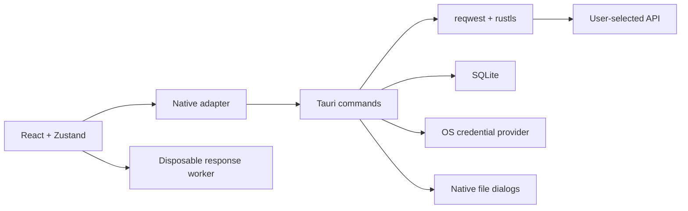

# Architecture

Relay embeds a Vite-built React frontend in a Tauri 2 system webview. No hosted server, Node backend, login, telemetry, or background listener runs in production.

`src/lib/types.ts` contains domain types; `bridge.ts` isolates desktop IPC from the UI. Browser use explicitly rejects native operations. `request.ts` resolves variables/auth into a transport-neutral request. `store.ts` manages metadata, drafts, results and collection execution. The HTTP engine and database compile and test without Tauri under `--no-default-features`.

## Persistence

SQLite uses bundled rusqlite, WAL, FULL synchronization, a busy timeout and foreign keys. Version 1 migrations create:

| Table          | Purpose                                                                                                                                                  |
| -------------- | -------------------------------------------------------------------------------------------------------------------------------------------------------- |
| `nodes`        | Projects, collections, folders, requests; parent foreign key/cascade, project/parent/name and favorite indexes. JSON payload retrieved only when needed. |
| `environments` | Global or project-specific variables, indexed project ID. Secret values are native keychain references.                                                  |
| `history`      | Metadata only: request ID, name, method, URL with redacted query, status, timing, size, timestamp. Newest 200 exposed; retention configurable 0–10,000.  |
| `settings`     | Workspace selection, saved session IDs, active environment and retention. Unsaved request content is not silently persisted.                             |
| `migrations`   | Applied versions; `user_version` rejects databases from newer incompatible versions.                                                                     |

A project is limited to 20,000 entities and 64 nested levels. Parent validation rejects cycles and cross-project moves. Imports are bounded to 16 MiB/10,000 nodes and wrapped in a savepoint with complete rollback on invalid entities. The Unix application-data directory is private (0700). SQLite itself is not encrypted; use the keychain for secrets.

The selected project's metadata is loaded; other request payloads are not. Tree rows are windowed around the current scroll position. Draft dirty flags avoid repeatedly serializing large uploads to compare state. Collection runs load saved requests sequentially into temporary tabs and release each response after recording results.

Portable JSON contains a format/version, stable exported IDs, nodes and environments. Import remaps IDs to avoid collisions. Exports omit attachments, keychain references/values, marked secrets and recognized authentication fields. Bodies/custom fields can still contain secrets and require review. History and credentials are not part of this portable backup.

## Native networking and credentials

reqwest/rustls validates HTTP(S) URLs and TLS certificates. URL userinfo and injected headers are rejected; Host, Content-Length and Transfer-Encoding are engine-controlled. Request text and uploads are bounded to 16 MiB. Streamed, decompressed responses default to 16 MiB, capped at 32 MiB. Connection timeout is 15 seconds; overall timeout is clamped to 100 ms–300 seconds. Eight network operations run concurrently, with at most 32 active/queued IDs. Cancellation drops the future and releases its permit.

Redirects follow only the original origin, including scheme and port, with a maximum of ten. Cross-origin redirects and TLS downgrades return their 3xx response for inspection. Local/private addresses are intentionally allowed for developer APIs. System proxy settings are used by reqwest. Custom proxy profiles and client-certificate configuration are not implemented.

The renderer can set/delete credentials in a fixed OS-keychain service but cannot read stored values. It persists opaque references. The native command resolves references immediately before transmission and performs Basic encoding after secret resolution. Secret query values are encoded through the URL query serializer. Secrets in URL paths are rejected. Missing/locked keychain services fail explicitly without plaintext fallback. The original application identifier and keychain service remain stable across the Relay rebrand.

## Auth, scopes and workflows

Variable precedence: Globals (global environment with that exact name), project, collection, nested folder, active environment, request. Missing/cyclic references fail before transmission. Authentication inherits the closest explicit parent unless overridden. OAuth client credentials and manual refresh-token grants run through the native engine; browser-consent/automatic refresh flows are deferred.

Declarative assertions and extraction replace arbitrary imported scripts. Collection order is name order; numeric name prefixes establish chains. JSON-path extraction updates the active environment; the response inspector can capture immediately using the keychain.

## Response processing and safety

CodeMirror viewport rendering is lazy-loaded. Schema validation and JSON formatting run in a disposable module worker terminated after three seconds. The schema interpreter needs no eval/new Function. JSON tree mode is limited to 512 KiB with lazy expansion and 100-child batches. Pretty formatting is limited to 4 MiB. Larger bodies remain available raw and by native download; there is no unbounded stream buffering.

HTML preview uses an empty iframe sandbox and an additional no-script/no-network CSP. Image preview excludes SVG. Native file access requires a user-initiated open/save dialog; no command accepts arbitrary file paths. Export writes a private temporary file and renames it into the selected destination.

## UI and distribution

See [DESIGN.md](DESIGN.md) for the request-recipe interaction, side-by-side/stacked layout, optional library, and original mint/amber identity. UI-only layout preferences use localStorage; workspaces use SQLite. Native close requests are intercepted when drafts are dirty.

Windows uses WebView2, macOS WKWebView, Linux WebKitGTK 4.1. Builds use Rust 1.99.1 and Node 24. CI config targets Linux deb, Windows NSIS and macOS DMG. Linux was exercised locally; Windows/macOS builds and runtime require independent CI/OS validation. Public distribution needs signing/notarization and update policy work.
